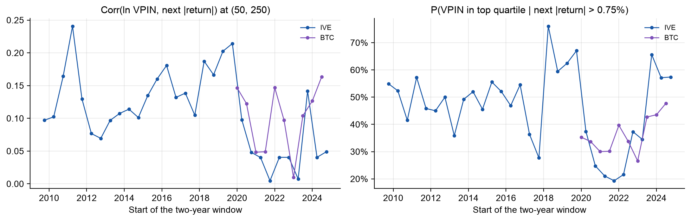
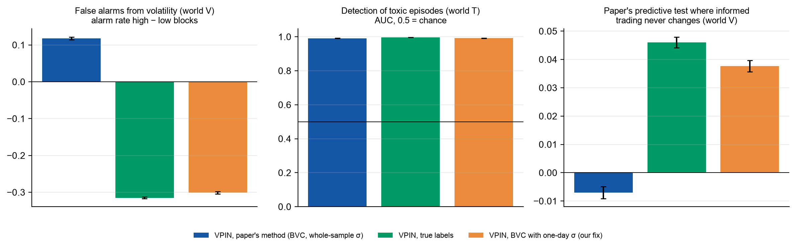

# Flow Toxicity and VPIN on Free Data

**Contributors:** _names to be added by the team_

A replication of Easley, López de Prado and O'Hara, *Flow Toxicity and Liquidity in a High-Frequency World* (Review of Financial Studies 25(5), 2012), on free data: IVE ETF ticks instead of E-mini S&P 500 futures. Beyond the paper: four experiments on IVE and on Binance BTCUSDT (where the true buyer and seller of every trade are known); a pre-registered known-answer simulation of the paper's own model; a one-line fix of bulk classification, tested on real data; and an inference package (placebo, stability, power and a ledger of every test with multiple-testing corrections).

VPIN (Volume-Synchronized Probability of Informed Trading) measures how one-sided trading is, in volume time. The paper argues that high VPIN warns of toxicity-induced volatility, for example hours before the 6 May 2010 flash crash. We rebuild every step from raw ticks, compare each exhibit with the paper, and then test the parts the paper could not: whether bulk volume classification gets buys and sells right, whether VPIN predicts anything out of sample without look-ahead, and whether it carries information beyond plain volatility.

Seminar presentation: [docs/presentation.pptx](docs/presentation.pptx) ([PDF](docs/presentation.pdf)). A written guide to the presentation, including why some results did not reproduce and what each extension adds: [docs/presentation_guide.pdf](docs/presentation_guide.pdf).
Every deviation from the paper, and every decision where the paper is silent: [DEVIATIONS.md](DEVIATIONS.md).

## Results

<!-- results:start -->
<!-- Generated by scripts/make_report.py from results/. Do not edit by hand. -->

"±" is a standard error from a block bootstrap that resamples whole calendar months (1,000 replications, `src/vpin/uncertainty.py`); brackets are 95% percentile intervals. Months, not single buckets, are resampled because VPIN windows overlap and volatility clusters. The paper's numbers and ours are never in the same table: the data, market and period differ.

### Reproduction on IVE, 2009-09-28 to 2011-08-15 (475 days, 942,321 trades)

**What the paper reports** (E-mini S&P 500 futures, 2008–2011):

| # | Claim | Paper reports (E-mini, 2008–11) | Where |
|---|---|---|---|
| 1 | VPIN does not depend on where the bucket sequence starts (std / mean across 1,000 starts) | 6.5% | Fig. 5 |
| 2 | Volume time is closer to normal than clock time: Kurt, J-B*, L-B*, White* lower | 4 of 4 at 50 and at 100 draws a day | Table 1 |
| 3 | CDF(VPIN) > 0.9 at least 2 h before the flash crash: BVC, one-minute bars | ≥ 2 h | Fig. 4(a) |
| 4 | ... BVC, 10-second bars | ≥ 2 h | Fig. 4(b) |
| 5 | ... Lee-Ready, trade by trade | ≥ 2 h | Fig. 4(c) |
| 6 | Low VPIN (bottom quartile) → next \|return\| < 0.25% | > 90% | Table 4a, p. 30 |
| 7 | Corr(ln VPIN, next \|return\|) at (50, 250) | 0.40 [0.392, 0.408] | Fig. 10, fn. 29 |
| 8 | P(VPIN in top quartile \| next \|return\| > 0.75%) at (50, 250) | > 84% | Sec. 5.2 |
| 9 | P(move > 0.75% while VPIN stays in the top quartile) at (50, 250) | 51.8% | Fig. 14 |
| 10 | ... at (10, 350) | 78.6% | Table 5 |

**What we find on IVE** (same row numbers). Verdict rule, on our data only: *reproduced* if the paper's value lies inside our 95% interval and the effect's direction is significant (correlation > 0; top-quartile VPIN beats bottom-quartile; lift > 1); *inconclusive* if inside but the direction is not significant; *weaker* if outside but the direction holds; *not reproduced* otherwise.

| # | Ours on IVE, 2009–11 (± s.e.) | 95% interval | Verdict |
|---|---|---|---|
| 1 | 3.7% | dispersion over 1,000 starts | reproduced |
| 2 | significantly lower: 1 of 4 (50/day), 2 of 4 (100/day); point estimates lower: 3 and 4 of 4 | paired bootstrap, P ≥ 0.95 | partly |
| 3 | 4.9 h | one event: no ± | reproduced |
| 4 | only during the fall | one event: no ± | not reproduced |
| 5 | never (max CDF 0.85) | one event: no ± | not reproduced |
| 6 | 96.1% ± 0.5% | [95.0%, 97.2%] | reproduced |
| 7 | 0.08 ± 0.05 | [0.04, 0.22] | weaker |
| 8 | 51% ± 13% | [19%, 71%] | weaker |
| 9 | 34% ± 4% | [26%, 43%] | weaker |
| 10 | 60% ± 12% | [37%, 85%] | inconclusive |

Low VPIN goes with calm markets, and VPIN does not depend on where the volume clock starts. VPIN's link to future volatility has the paper's sign but is much smaller. Overnight gaps do not explain this: without buckets that span the close, the correlation at (50, 250) is 0.08. An iid Fisher interval, the paper's method (footnote 29), would give our correlation as [0.07, 0.09], several times narrower than the month-block interval [0.04, 0.22]: it ignores that neighbouring buckets share most of their VPIN window.

**Table 1, the paper's version** (E-mini, 50 draws a day):

| Statistic | Clock time | Volume time |
|---|---|---|
| Kurt | 34.25 | 20.52 |
| J-B* | 40.69 | 12.82 |
| L-B* | 40.73 | 24.84 |
| White* | 0.10 | 0.04 |
| Max | 20.83 | 12.26 |

**Table 1, ours** (IVE, 50 draws a day, without 6 May 2010 and overnight changes; "P(volume lower)" = share of paired bootstrap replications in which volume time has the lower value):

| Statistic | Clock time | Volume time | P(volume lower) |
|---|---|---|---|
| Kurt | 13.12 ± 3.96 | 9.05 ± 1.81 | 0.947 |
| J-B* | 4.27 ± 3.11 | 1.53 ± 0.89 | 0.947 |
| L-B* | 23.13 ± 32.34 | 43.03 ± 25.23 | 0.313 |
| White* | 0.28 ± 0.10 | 0.16 ± 0.06 | 0.995 |
| Max | 13.08 ± 2.29 | 9.86 ± 1.51 | 0.977 |


### E1. Bulk classification against the truth (BTCUSDT, Binance)

Binance records the aggressor of every trade, so the true buy volume is known.

- One-minute bars: BVC gets the sign of the imbalance right for 82.1% ± 0.2% of volume (79%–83% by year); its buy share correlates 0.60 ± 0.01 with the true one.
- Buckets: BVC inflates the size of the imbalance 2.2 times (mean |imbalance| 0.22 vs 0.10), and the two VPINs correlate only 0.39 ± 0.04.
- BVC's imbalance is tied to the bucket's own price move (0.44 ± 0.01 vs 0.29 ± 0.02 for the true imbalance): it partly measures volatility by construction.
- On 5 trade days the tick rule classifies 93%–97% of volume correctly; bucket imbalance from the tick rule correlates ≥ 0.99 with the truth, BVC only 0.51–0.74 (1-minute bars) and 0.55–0.83 (10-second bars); ranges are across the 5 days. Caveat: Binance's aggregated trades group the fills of one order, which helps the tick rule.


### E2. Is VPIN more than volatility?

"Lift" = P(signal in its top quartile | next |return| > 0.75%) divided by the share of time the signal is in its top quartile. A signal that is always "on" has a high hit rate and a lift of 1.

| Signal (50 buckets/day, n = 50) | Corr with next \|return\| | P(top quartile \| big move) | Share of time in top quartile | Lift |
|---|---|---|---|---|
| VPIN (bulk classified) | 0.13 ± 0.02 | 41% ± 3% | 27% | 1.53 ± 0.08 |
| VPIN (true labels) | -0.12 ± 0.02 | 17% ± 3% | 29% | 0.61 ± 0.08 |
| RV (trailing volatility) | 0.36 ± 0.03 | 40% ± 7% | 12% | 3.31 ± 0.28 |

VPIN from **true** labels is negatively related to the next move; bulk-classified VPIN is positive, and trailing volatility beats both. Whatever predictive power VPIN has comes from its volatility component. In regressions of the next |return| on ln VPIN with volatility and trade-intensity controls, VPIN's coefficient is significantly negative on BTC (Newey–West t = -7.7) and positive on IVE out of sample (t = 7.0); either way it adds little: ΔR² = 0.0010 and 0.0025 (`results/extensions/regressions.csv`). The t-statistic is the test; ΔR² cannot be negative, so its bootstrap interval is not one.

### Further check A: real-time VPIN out of sample (IVE after 2011-08-15)

No look-ahead: sigma, bucket size and the CDF use only past data. Parameters are the paper's, or chosen the paper's way on the in-sample period and then frozen (best in-sample correlation: (10, 450); best in-sample true-positive rate: (20, 500)). All rows come from the same IVE data.

| Parameters | Period | Corr VPIN | Corr RV | Lift VPIN | Lift RV | True positives top − bottom quartile, VPIN | ... RV |
|---|---|---|---|---|---|---|---|
| paper (50, 250) | in-sample | 0.11 ± 0.06 | 0.13 ± 0.07 | 2.46 ± 0.75 | 2.21 ± 0.48 | -0% ± 10% | 13% ± 5% |
| paper (50, 250) | out-of-sample | 0.09 ± 0.03 | 0.24 ± 0.02 | 1.57 ± 0.20 | 2.76 ± 0.28 | 4% ± 2% | 22% ± 2% |
| paper Table 5 (10, 350) | in-sample | 0.28 ± 0.08 | 0.27 ± 0.06 | 2.66 ± 1.04 | 2.10 ± 0.69 | 8% ± 19% | -2% ± 12% |
| paper Table 5 (10, 350) | out-of-sample | 0.10 ± 0.05 | 0.28 ± 0.03 | 1.34 ± 0.15 | 2.51 ± 0.23 | 3% ± 5% | 19% ± 4% |
| best in-sample corr | in-sample | 0.32 ± 0.07 | 0.27 ± 0.06 | 3.35 ± 1.31 | 2.56 ± 0.66 | 27% ± 23% | 39% ± 11% |
| best in-sample corr | out-of-sample | 0.09 ± 0.04 | 0.26 ± 0.02 | 1.32 ± 0.15 | 2.49 ± 0.23 | -5% ± 7% | 23% ± 5% |
| best in-sample true positive | in-sample | 0.11 ± 0.08 | 0.08 ± 0.09 | 2.84 ± 0.86 | 2.51 ± 0.75 | 54% ± 7% | 10% ± 7% |
| best in-sample true positive | out-of-sample | 0.10 ± 0.04 | 0.26 ± 0.02 | 1.42 ± 0.18 | 2.67 ± 0.26 | -2% ± 4% | 17% ± 4% |

In-sample → out-of-sample correlation of VPIN: paper (50, 250) 0.11 ± 0.06 → 0.09 ± 0.03; paper Table 5 (10, 350) 0.28 ± 0.08 → 0.10 ± 0.05; best in-sample corr 0.32 ± 0.07 → 0.09 ± 0.04; best in-sample true positive 0.11 ± 0.08 → 0.10 ± 0.04. Out of sample, trailing volatility's correlation exceeds VPIN's by more than two standard errors for 4 of 4 parameter choices.


### Further check B: crashes after the paper

Was the real-time alarm (CDF ≥ 0.9, 50 buckets/day, n = 50) on when the day's largest one-hour fall began?

| Market | Day | Largest 1-hour fall | VPIN alarm | True-label VPIN alarm | RV alarm |
|---|---|---|---|---|---|
| BTC | 2021-05-19 | -22.9% | on | off | off |
| BTC | 2024-08-05 | -8.9% | off | off | off |
| BTC | 2025-10-10 | -11.6% | off | on | off |
| IVE | 2011-08-08 | -3.2% | on | – | on |
| IVE | 2015-08-24 | -5.1% | on | – | on |
| IVE | 2018-02-05 | -2.7% | on | – | off |
| IVE | 2020-03-16 | -4.6% | on | – | on |
| IVE | 2024-08-05 | -1.0% | on | – | off |

| Market | Alarm | On at falls | On overall | Binomial p-value |
|---|---|---|---|---|
| BTC | VPIN (bulk classified) | 1 of 3 | 10% | 0.261 |
| BTC | VPIN (true labels) | 1 of 3 | 14% | 0.355 |
| BTC | RV (trailing volatility) | 0 of 3 | 3% | 1.000 |
| IVE | VPIN (bulk classified) | 5 of 5 | 15% | < 0.001 |
| IVE | RV (trailing volatility) | 3 of 5 | 9% | 0.006 |

The binomial p-value is the chance of at least that many hits if the alarm were on at each fall independently with its overall rate; falls are few and not independent of the market's state, so read it as a rough guide. On IVE the VPIN alarm was on at every fall, the extension result most favourable to VPIN; on BTC no alarm was reliable.

### All two-year windows: do the paper's predictive numbers appear anywhere?

The paper's exact in-sample method (whole-window σ and CDF) on every two-year window, starting each January and July (`scripts/windows.py`; run once as an exploration before the pre-registration, so labelled exploratory). Every window is reported. For comparison, the paper reports 0.40 for the correlation and over 84% for P(top quartile | big move).

| Market | Two-year windows | Corr at (50, 250) | P(top quartile \| big move) | True positives (10, 350), VPIN top quartile | ... bottom quartile |
|---|---|---|---|---|---|
| BTC | 10 | 0.01 to 0.16 | 27% to 48% | 71% to 85% | 77% to 94% |
| IVE | 31 | 0.00 to 0.24 | 19% to 76% | 23% to 73% | 15% to 57% |

On BTC a 0.75% move is routine, so the true-positive rate is as high or higher when VPIN is *low*: the statistic says nothing there.



### E3. A known-answer test of VPIN (simulation, pre-registered)

The paper's own Monte Carlo (Appendix A.2) draws buys and sells straight from the PIN model, with correct labels and no prices. Its empirical VPIN, however, labels trades by bulk classification, which needs prices. We simulate the paper's model **with prices**, where the true share of informed trading is known, and run the same pipeline. There are four worlds: constant (0), more informed trading in some blocks of days (T), more public volatility and uninformed volume in some blocks with informed trading unchanged (V), and both (TV). Design, metrics and decision rules were fixed in [docs/preregistration.md](docs/preregistration.md) before the first run (SHA-256 in `results/extensions/simulation/run_manifest.json`). There are 200 replications per world; ± is the Monte Carlo standard error.

| VPIN version | Tracks informed share, world V (corr) | False alarms from volatility, world V | Detection AUC, world T | Paper's predictive test, world V |
|---|---|---|---|---|
| paper's method (BVC, whole-sample σ) | 0.034 ± 0.0049 | +0.118 ± 0.002 | 0.991 ± 0.0005 | -0.007 ± 0.001 |
| true labels | 0.964 ± 0.0004 | -0.315 ± 0.001 | 0.996 ± 0.0002 | +0.046 ± 0.001 |
| BVC with one-day σ (our fix) | 0.834 ± 0.0018 | -0.301 ± 0.002 | 0.992 ± 0.0004 | +0.038 ± 0.001 |

| Rule | Pre-registered statement | Result | Verdict |
|---|---|---|---|
| D1 | true-label VPIN tracks informed trading (M1 > 0.5, world T) | 0.98 | holds |
| D2 | the paper's VPIN raises false alarms from volatility alone | +0.118 | holds |
| D3 | the paper's predictive test is fooled by volatility (positive corr in world V) | -0.007 | does not hold |
| D4 | the one-day-σ fix halves false alarms and keeps detection | -0.301 vs +0.118; AUC 0.992 vs 0.991 | holds |

When volatility changes but informed trading does not, the paper's VPIN stops tracking informed trading and raises alarms in turbulent blocks. VPIN from the true labels moves the other way: extra uninformed volume dilutes the informed share. That is the same sign we find on real BTC data (E2). Measuring each price change against the previous day's volatility removes the bias without losing detection. D3 did not hold in this calibration: the two effects roughly cancel in the paper's predictive statistic. The tick-rounded variant gives the same decisions (`decisions_tick.json`).



### E4. The fix on real data (pre-registered rule D5)

Bulk classification with σ from the previous day only ("local σ"), in the same real-time buckets:

- On BTC, where the truth is known, local-σ VPIN tracks true-label VPIN better: correlation 0.47 vs 0.39 at (50, 50), difference +0.082 ± 0.019; and 0.40 vs 0.27 at (50, 250).
- Once the volatility bias is removed, most of VPIN's link to future volatility disappears:

| Market | Setting | Signal | Corr with next \|return\| | Lift |
|---|---|---|---|---|
| BTC | (50, 50) | VPIN, standard BVC | 0.127 ± 0.020 | 1.53 ± 0.08 |
| BTC | (50, 50) | VPIN, local-sigma BVC (fix) | 0.051 ± 0.017 | 1.27 ± 0.07 |
| BTC | (50, 50) | trailing volatility | 0.359 ± 0.032 | 3.31 ± 0.28 |
| BTC | (50, 50) | VPIN, true labels | -0.123 ± 0.024 | 0.61 ± 0.08 |
| BTC | (50, 250) | VPIN, standard BVC | 0.112 ± 0.028 | 1.52 ± 0.12 |
| BTC | (50, 250) | VPIN, local-sigma BVC (fix) | 0.021 ± 0.028 | 1.20 ± 0.10 |
| BTC | (50, 250) | trailing volatility | 0.347 ± 0.032 | 3.32 ± 0.33 |
| BTC | (50, 250) | VPIN, true labels | -0.161 ± 0.027 | 0.50 ± 0.08 |
| IVE 2011-26 | (50, 250) | VPIN, standard BVC | 0.092 ± 0.031 | 1.57 ± 0.20 |
| IVE 2011-26 | (50, 250) | VPIN, local-sigma BVC (fix) | 0.007 ± 0.023 | 1.30 ± 0.24 |
| IVE 2011-26 | (50, 250) | trailing volatility | 0.242 ± 0.018 | 2.76 ± 0.28 |

- Beyond trailing volatility, last return and trading intensity (Newey–West t): local-σ VPIN t = 8.3 on IVE 2011–2026 (ΔR² = 0.0029); t = -4.3 on BTC (50, 50), where the coefficient is negative.

### Inference: placebo, stability, power and a ledger of every test

- **Placebo** (direction-shuffled VPIN): each one-minute imbalance keeps its size but gets a random direction. If VPIN's predictive power came from the direction of trading (informed traders on one side), the placebo would lose it.

| Sample | Corr, real VPIN | Corr, direction-shuffled (20 draws) | Share kept | Lift, real | Lift, shuffled |
|---|---|---|---|---|---|
| IVE 2009-11, paper's method (50, 250) | 0.078 | 0.078 ± 0.002 | 101% | 2.04 | 2.02 |
| IVE 2011-26, real-time (50, 250) | 0.092 | 0.090 ± 0.001 | 98% | 1.57 | 1.58 |
| BTC 2020-26, real-time (50, 50) | 0.127 | 0.128 ± 0.001 | 101% | 1.53 | 1.53 |

The placebo keeps essentially all of VPIN's predictive power in every sample. The power comes from the size of price moves, not from the direction of order flow.

- **Leave one year out:**

| Sample | Signal | Corr, leaving one year out (min to max) | Sign flips | Years |
|---|---|---|---|---|
| IVE 2011-26, real-time (50, 250) | VPIN | 0.064 to 0.099 | 0 | 16 |
| IVE 2011-26, real-time (50, 250) | trailing volatility | 0.221 to 0.254 | 0 | 16 |
| BTC 2020-26, real-time (50, 50) | VPIN | 0.115 to 0.157 | 0 | 7 |
| BTC 2020-26, real-time (50, 50) | trailing volatility | 0.272 to 0.374 | 0 | 7 |
| BTC 2020-26, real-time (50, 50) | VPIN, true labels | -0.150 to -0.039 | 0 | 7 |

- **Power:** the reproduction's month-block standard error for the correlation at (50, 250) is 0.047, so the smallest correlation it could detect with 80% power is 0.13. The paper's 0.40 would have been detected easily; the gap is not a matter of power.
- **Ledger** (`results/report/ledger.csv`): 26 tests behind our claims. 17 are supported after Benjamini–Hochberg and 13 after Bonferroni, counting a claim as supported only if it is significant **and** on the claimed side. 3 are significant in the opposite direction (for example, D3 and VPIN's negative coefficient beyond volatility on BTC) and are reported as not supported. The reproduction's own correlation at (50, 250) is borderline: z = 1.64 with the normal approximation, although the skewed bootstrap interval excludes zero. With about two years of months to resample, we call it weakly positive.

<!-- results:end -->

## Data

- **IVE ticks** (iShares S&P 500 Value ETF) from Kibot's free sample data: every trade with its bid and ask, 28 Sep 2009 – 30 Sep 2026. The reproduction uses the paper's period (to 15 Aug 2011); everything after it is out of sample.
- **BTCUSDT perpetual futures** from Binance public data: one-minute klines with the true taker-buy volume (2020–2026), and individual trades with the aggressor side for five days.
- Raw data are not committed. [data/README.md](data/README.md) describes every format; `data/samples/` has a few hundred rows of each.

## How to run

```bash
python3 -m venv .venv && source .venv/bin/activate
python -m pip install -r requirements.txt
pytest -q
```

```bash
python scripts/download_kibot.py      # ~50 MB, about 1 hour (one request per month)
python scripts/download_binance.py    # ~550 MB
python scripts/reproduce.py --smoke   # three months, about 20 s: checks the pipeline
python scripts/reproduce.py           # the paper's exhibits on IVE, about 1 minute
python scripts/extensions.py          # E1-E4, about 2 minutes
python scripts/windows.py             # the paper's method on every two-year window
python scripts/simulation.py          # pre-registered known-answer simulation, ~1 minute
python scripts/local_sigma.py         # the one-day-sigma fix on real data (rule D5)
python scripts/inference.py           # placebo, leave-one-year-out, power, ledger
python scripts/make_report.py         # rewrites the results section of this README
python scripts/make_slides.py --paper "<path to the paper PDF>"   # docs/presentation.pptx
python scripts/make_guide.py          # docs/presentation_guide.pdf (after make_slides.py)
```

Settings live in [configs/pipeline.yaml](configs/pipeline.yaml). The reproduction uses the paper's: one-minute bars, bulk volume classification, V = average daily volume / 50, n = 50, and a CDF from the whole sample. Results go to `results/reproduction/` and `results/extensions/` (CSV and JSON, with figures in `figures/`).

Environment of the reported run: <!-- env:start -->Python 3.13.15, Darwin 26.6.2, Apple M5 Pro<!-- env:end -->. Everything is deterministic; no random numbers are drawn.

## Layout

```
src/vpin/
  data.py          load IVE ticks, BTC klines and trades; remove the trades cancelled on 6 May 2010
  bars.py          one-minute (or any) time bars, within-day price changes
  classify.py      bulk volume classification, tick rule, Lee-Ready
  buckets.py       equal-volume buckets (fixed or day-by-day size)
  metric.py        VPIN, full-sample and expanding CDFs
  analysis.py      statistics behind Tables 1-5 and Figures 10-14
  realtime.py      real-time pipeline: sigma, V and CDF from past data only
  simulation.py    the paper's PIN model with prices (known-answer simulation)
  uncertainty.py   month-block bootstrap for every ±
  plots.py         all figures
  paper_numbers.py the paper's numbers, each with its exhibit and page
scripts/           downloads, reproduce.py, extensions.py, make_report.py, make_slides.py, make_samples.py
configs/           pipeline settings
data/              data README and samples
results/           reproduction/, extensions/, report/ (key numbers and scorecard)
docs/              presentation, guide, pre-registration and slide template
tests/             unit tests
```
