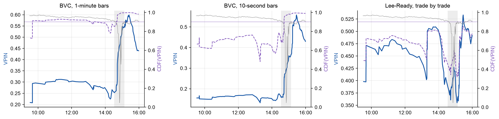
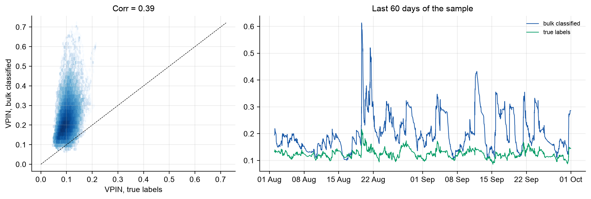
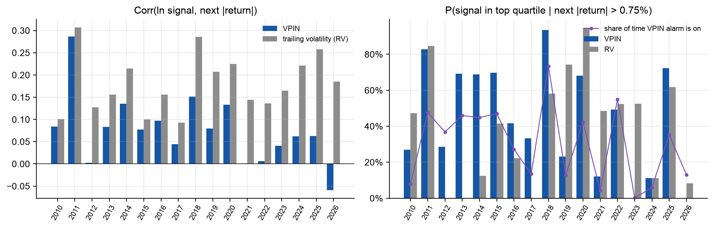

# Flow Toxicity and VPIN on Free Data

**Contributors:** _names to be added by the team_

A replication of Easley, López de Prado and O'Hara, *Flow Toxicity and Liquidity in a High-Frequency World* (Review of Financial Studies 25(5), 2012), on free data: IVE ETF ticks instead of E-mini S&P 500 futures, plus four experiments beyond the paper on IVE and on Binance BTCUSDT, where the true buyer and seller of every trade are known.

VPIN (Volume-Synchronized Probability of Informed Trading) measures how one-sided trading is, in volume time. The paper argues that high VPIN warns of toxicity-induced volatility, for example hours before the 6 May 2010 flash crash. We rebuild every step from raw ticks, compare each exhibit with the paper, and then test the parts the paper could not: whether bulk volume classification gets buys and sells right, whether VPIN predicts anything out of sample without look-ahead, and whether it carries information beyond plain volatility.

Seminar presentation: [docs/presentation.pptx](docs/presentation.pptx) ([PDF](docs/presentation.pdf)).
Every deviation from the paper, and every decision where the paper is silent: [DEVIATIONS.md](DEVIATIONS.md).

## Results

<!-- results:start -->
<!-- Generated by scripts/make_report.py from results/. Do not edit by hand. -->

### Reproduction on IVE, 2009-09-28 to 2011-08-15 (475 days, 942,321 trades)

Verdict rule for numeric claims: ours / paper ≥ 0.8 "reproduced", 0.4–0.8 "weaker", below 0.4 "much weaker".

| Claim | Paper (E-mini) | Ours (IVE) | Verdict |
|---|---|---|---|
| VPIN is stable to the starting point (Fig. 5): std / mean across 1,000 starts | 6.5% | 3.7% | reproduced |
| Volume time is closer to normal than clock time (Table 1): statistics that improve, 50 / 100 draws a day | 4 of 4 / 4 of 4 | 3 of 4 / 4 of 4 (without 6 May 2010 and overnight changes) | reproduced |
| CDF(VPIN) > 0.9 at least 2 hours before the flash crash (Fig. 4), BVC 1-minute bars | ≥ 2 h | 4.9 h | reproduced |
| ... with BVC 10-second bars | ≥ 2 h | only during the crash | not reproduced |
| ... with Lee-Ready trade-by-trade classification | ≥ 2 h | never (max CDF 0.85) | not reproduced |
| Low VPIN (bottom quartile) → next \|return\| < 0.25% (Table 4a) | > 90% | 96% | reproduced |
| Corr(ln VPIN, next \|return\|) at (50, 250) (Fig. 10) | 0.40 | 0.08 | much weaker |
| P(VPIN in top quartile \| next \|return\| > 0.75%) at (50, 250) (Sec. 5.2) | > 84% | 51% | weaker |
| P(move > 0.75% while VPIN stays in the top quartile) at (50, 250) (Fig. 14) | 51.8% | 33.6% | weaker |
| ... at (10, 350) (Table 5) | 78.6% | 59.7% | weaker |

The mechanics reproduce: VPIN does not depend on where the bucket sequence starts, volume time makes returns more normal, and low VPIN goes with calm markets. The predictive claims are much weaker on IVE. Overnight gaps do not explain it: without buckets that span the close, the correlation at (50, 250) is 0.08 (all buckets: 0.08). The largest correlation anywhere on the grid is 0.10, at 30 buckets/day and n = 70.



### E1. Bulk classification against the truth (BTCUSDT, Binance)

Binance records the aggressor of every trade, so the true buy volume is known.

- One-minute bars: BVC gets the sign of the imbalance right for 79%–83% of volume, depending on the year.
- Buckets: BVC inflates the size of the imbalance 2.2 times (mean |imbalance| 0.22 vs 0.10), and the two VPINs correlate only 0.39.
- BVC's imbalance is tied to the bucket's own price move (0.44 vs 0.29 for the true imbalance): it partly measures volatility by construction.
- On 5 trade days the tick rule classifies 93%–97% of volume correctly; bucket imbalance from the tick rule correlates ≥ 0.99 with the truth, BVC only 0.51–0.74 (1-minute bars) and 0.55–0.83 (10-second bars). Caveat: Binance's aggregated trades group the fills of one order, which helps the tick rule.



### E3. Is VPIN more than volatility?

"Lift" = P(signal in its top quartile | next |return| > 0.75%) divided by the share of time the signal is in its top quartile. A signal that is always "on" has a high hit rate and a lift of 1.

| Signal (50 buckets/day, n = 50) | Corr with next \|return\| | P(top quartile \| big move) | Share of time in top quartile | Lift |
|---|---|---|---|---|
| VPIN (bulk classified) | 0.13 | 41% | 27% | 1.5× |
| VPIN (true labels) | -0.12 | 17% | 29% | 0.6× |
| RV (trailing volatility) | 0.36 | 40% | 12% | 3.3× |

VPIN from **true** labels has a negative correlation with the next move (-0.12); VPIN from bulk classification is positive (0.13), and trailing volatility beats both (0.36). Whatever predictive power VPIN has comes from its volatility component. In regressions of the next |return| on ln VPIN with volatility and trade-intensity controls (Newey–West errors), VPIN adds ΔR² = 0.0010 on BTC and 0.0025 on IVE out of sample (`results/extensions/regressions.csv`).

### E2. Real-time VPIN, out of sample (IVE after 2011-08-15)

No look-ahead: sigma, bucket size and the CDF use only past data. Parameters are the paper's, or chosen the paper's way on the in-sample period and then frozen (best in-sample correlation: (10, 450); best in-sample true-positive rate: (20, 500)).

| Parameters | Period | Corr VPIN | Corr RV | Lift VPIN | Lift RV | True positives, VPIN top quartile | ... bottom quartile |
|---|---|---|---|---|---|---|---|
| paper (50, 250) | in-sample | 0.11 | 0.13 | 2.5× | 2.2× | 27% | 27% |
| paper (50, 250) | out-of-sample | 0.09 | 0.24 | 1.6× | 2.8× | 27% | 23% |
| paper Table 5 (10, 350) | in-sample | 0.28 | 0.27 | 2.7× | 2.1× | 50% | 42% |
| paper Table 5 (10, 350) | out-of-sample | 0.10 | 0.28 | 1.3× | 2.5× | 49% | 45% |
| best in-sample corr | in-sample | 0.32 | 0.27 | 3.4× | 2.6× | 71% | 44% |
| best in-sample corr | out-of-sample | 0.09 | 0.26 | 1.3× | 2.5× | 52% | 57% |
| best in-sample true positive | in-sample | 0.11 | 0.08 | 2.8× | 2.5× | 92% | 38% |
| best in-sample true positive | out-of-sample | 0.10 | 0.26 | 1.4× | 2.7× | 45% | 47% |

In-sample → out-of-sample correlation of VPIN: paper (50, 250) 0.11 → 0.09; paper Table 5 (10, 350) 0.28 → 0.10; best in-sample corr 0.32 → 0.09; best in-sample true positive 0.11 → 0.10. Trailing volatility (RV) has both the higher correlation and the higher lift out of sample for 4 of 4 parameter choices.



### E4. Crashes after the paper

Was the real-time alarm (CDF ≥ 0.9) on when the day's largest one-hour fall began?

| Market | Day | Largest 1-hour fall | VPIN alarm | True-label VPIN alarm | RV alarm |
|---|---|---|---|---|---|
| BTC | 2021-05-19 | -22.9% | on | off | off |
| BTC | 2024-08-05 | -8.9% | off | off | off |
| BTC | 2025-10-10 | -11.6% | off | on | off |
| IVE | 2011-08-08 | -3.2% | on | – | on |
| IVE | 2015-08-24 | -5.1% | on | – | on |
| IVE | 2018-02-05 | -2.7% | on | – | off |
| IVE | 2020-03-16 | -4.6% | on | – | on |
| IVE | 2024-08-05 | -1.0% | on | – | off |

IVE: the VPIN alarm (CDF ≥ 0.9, 50 buckets/day, n = 50) was on at 5 of 5 falls and is on 15% of all the time; the RV alarm was on at 3 and is on 9% of the time. This is the extension result most favourable to VPIN, but it rests on five events. BTC: bulk-classified VPIN was on at 1 of 3 falls, true-label VPIN at 1, RV at 0.

<!-- results:end -->

## Data

- **IVE ticks** (iShares S&P 500 Value ETF) from Kibot's free sample data: every trade with its bid and ask, 28 Sep 2009 – 30 Sep 2026. The reproduction uses the paper's period (to 15 Aug 2011); everything after it is out of sample.
- **BTCUSDT perpetual futures** from Binance public data: one-minute klines with the true taker-buy volume (2020–2026), and individual trades with the aggressor side for five days.
- Raw data are not committed. [data/README.md](data/README.md) describes every format; `data/samples/` has a few hundred rows of each.

## How to run

```bash
python3 -m venv .venv && source .venv/bin/activate
python -m pip install -r requirements.txt
pytest -q
```

```bash
python scripts/download_kibot.py      # ~50 MB, about 1 hour (one request per month)
python scripts/download_binance.py    # ~550 MB
python scripts/reproduce.py --smoke   # three months, about 20 s: checks the pipeline
python scripts/reproduce.py           # the paper's exhibits on IVE, about 1 minute
python scripts/extensions.py          # E1-E4, about 2 minutes
python scripts/make_report.py         # rewrites the results section of this README
python scripts/make_slides.py --paper "<path to the paper PDF>"   # docs/presentation.pptx
```

Settings live in [configs/pipeline.yaml](configs/pipeline.yaml). The reproduction uses the paper's: one-minute bars, bulk volume classification, V = average daily volume / 50, n = 50, and a CDF from the whole sample. Results go to `results/reproduction/` and `results/extensions/` (CSV and JSON, with figures in `figures/`).

Environment of the reported run: <!-- env:start -->Python 3.13.15, Darwin 26.6.2, Apple M5 Pro<!-- env:end -->. Everything is deterministic; no random numbers are drawn.

## Layout

```
src/vpin/
  data.py          load IVE ticks, BTC klines and trades; remove the trades cancelled on 6 May 2010
  bars.py          one-minute (or any) time bars, within-day price changes
  classify.py      bulk volume classification, tick rule, Lee-Ready
  buckets.py       equal-volume buckets (fixed or day-by-day size)
  metric.py        VPIN, full-sample and expanding CDFs
  analysis.py      statistics behind Tables 1-5 and Figures 10-14
  realtime.py      real-time pipeline: sigma, V and CDF from past data only
  plots.py         all figures
  paper_numbers.py the paper's numbers, each with its exhibit and page
scripts/           downloads, reproduce.py, extensions.py, make_report.py, make_slides.py, make_samples.py
configs/           pipeline settings
data/              data README and samples
results/           reproduction/, extensions/, report/ (key numbers and scorecard)
docs/              presentation and slide template
tests/             unit tests
```
